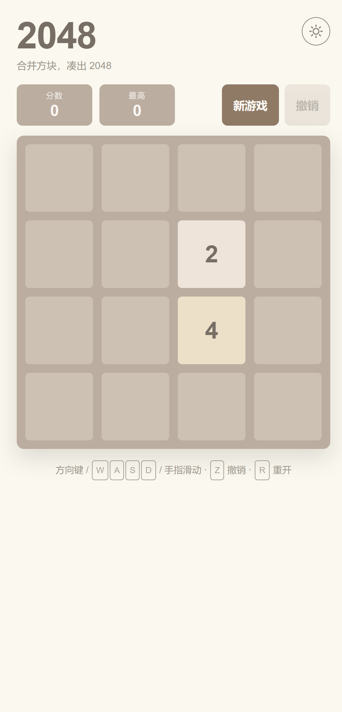
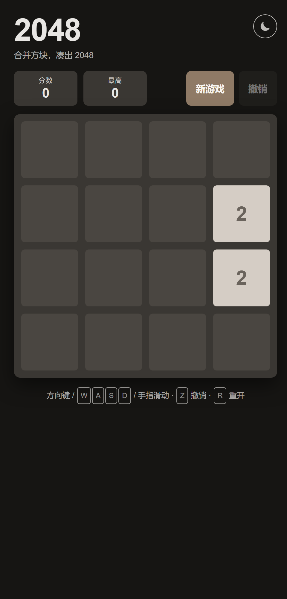

# 2048

一个零依赖、零构建的 2048 小游戏，纯原生 HTML / CSS / JavaScript（ES 模块），
克隆下来 `git push` 就能在 GitHub Pages 上玩。

## 特性

- **零依赖、零构建**：不装任何 npm 包，没有打包步骤，改完刷新即可见效
- **滑动 / 合并 / 新方块动画**：方块位置用 `transform` 过渡，合并与出现各有缩放动画
- **撤销**：最多回退 20 步（撤销按钮或快捷键 `Z`），游戏结束后也能撤销一步
- **进度持久化**：棋盘、分数、最高分保存在 `localStorage`；存储不可用时自动降级为内存模式
- **键盘 + 触摸**：方向键 / `WASD` / 手指滑动 / 鼠标拖拽
- **深浅色主题**：默认跟随系统，可手动切换并记住选择（首屏不闪烁）
- **响应式**：棋盘随视口缩放，375px 宽也不会横向滚动
- **无障碍**：完整键盘可达、可见焦点环、分数变化有 `aria-live` 播报、尊重 `prefers-reduced-motion`
- **逻辑有单测**：`node --test` 跑 16 个用例，含 200 局随机对局的不变量压力测试

## 预览

| 浅色 | 深色 |
| --- | --- |
|  |  |

## 本地预览

ES 模块不能通过 `file://` 直接打开（浏览器会拦截），需要用本地服务器：

```bash
node tools/serve.mjs          # → http://127.0.0.1:8080/
node tools/serve.mjs 5173     # 指定端口
```

`tools/serve.mjs` 也是零依赖的（只用 Node 内置模块），需要 Node 18+。

## 玩法

| 操作 | 按键 |
| --- | --- |
| 移动 | 方向键 或 `W` `A` `S` `D`（也可手指滑动、鼠标拖拽） |
| 撤销一步 | `Z` 或 `Ctrl+Z` |
| 重新开始 | `R` |

同值方块相撞即合并且分数增加；每次有效移动后随机出现一个新方块（90% 是 2，10% 是 4）。
凑出 2048 显示胜利提示，可选择继续挑战。

## 部署到 GitHub Pages

先把本地目录初始化为仓库并推上去（把 `2048` 换成你想用的仓库名，`<用户名>` 换成你的 GitHub 用户名）：

```bash
git init
git add .
git commit -m "feat: 2048 game"
git branch -M main
git remote add origin https://github.com/<用户名>/2048.git
git push -u origin main
```

然后**二选一**（不要同时启用）：

### 方式 A：从分支发布（推荐，零配置）

`Settings ▸ Pages ▸ Source` 选 **Deploy from a branch**，Branch 选 `main`、目录选 `/ (root)`，保存。
推送即在 `https://<用户名>.github.io/2048/` 生效。

此时可以删掉 `.github/workflows/deploy.yml`（留着也不影响，只要不要把 Pages 的 Source 切成 Actions）。

### 方式 B：GitHub Actions

`Settings ▸ Pages ▸ Source` 选 **GitHub Actions**。仓库自带的 `.github/workflows/deploy.yml`
会在每次推送 `main` 时先跑 `node --test`，再把仓库根目录原样发布上去（不做构建）。

> 所有资源都用相对路径（`./styles.css`、`./js/main.js`），因此放在 `/2048/` 子路径下正常；
> 把仓库改名成 `<用户名>.github.io` 直接当主页用，也不需要改任何代码。
> 根目录的 `.nojekyll` 用于避免 GitHub Pages 的 Jekyll 处理。

## 自测

```bash
node --test        # 或 npm test
```

覆盖：四个方向的移动与合并（含 `[2,2,2,2] → [4,4]`、`[4,4,8] → [8,8]`）、无效移动不生成方块、
新方块概率、撤销与历史上限、胜负判定、`movements` 动画契约、以及 200 局随机对局的状态不变量。

## 自定义

| 想改什么 | 改哪里 |
| --- | --- |
| 方块配色 | `js/render.js` 的 `TILE_COLORS`（2 ~ 2048 各一组 `[底色, 文字色]`，>2048 走深色兜底） |
| 页面配色 / 圆角 / 阴影 | `styles.css` 顶部的 CSS 变量（`:root` 为浅色，`html[data-theme='dark']` 为深色） |
| 动画时长 | `js/render.js` 顶部的 `BASE_DURATION`（slide 120ms / pop 150ms / appear 150ms） |
| 棋盘尺寸 | `js/main.js` 的 `SIZE`（改成 5 即 5×5；网格与动画都按尺寸通用实现） |
| 新方块出现 4 的概率 | `js/game.js` 的 `FOUR_RATE` |
| 撤销步数上限 | `js/game.js` 的 `HISTORY_LIMIT` |

## 目录结构

```
index.html                  页面结构 + 主题防闪烁内联脚本
styles.css                  全部样式（CSS 变量驱动深浅主题）
js/game.js                  核心逻辑（纯函数，无 DOM 依赖，可被 Node 直接测试）
js/render.js                渲染与动画（tile id → DOM 元素复用）
js/input.js                 键盘 + Pointer Events 手势
js/storage.js               localStorage 封装与内存降级
js/theme.js                 主题切换与跟随系统
js/main.js                  装配层：状态、按钮、胜负面板、aria-live
tools/serve.mjs             零依赖本地静态服务器
tests/game.test.mjs         node:test 逻辑自测
docs/preview-*.png          README 用的主题预览图（删掉不影响运行）
assets/favicon.svg          图标
.github/workflows/deploy.yml  可选：Actions 部署
.nojekyll                   阻止 Jekyll 处理
```

## 实现说明

- **数据模型**：棋盘是长度 `size*size` 的数组，元素为 `null | { id, value }`；`id` 跨移动保持不变，
  渲染层据此复用同一个 DOM 节点，从而让 `transform` 过渡成为真正的滑动动画。
- **合并规则**：`move()` 沿方向提取每一条线，压缩后相邻同值合并一次并立刻标记，
  保证合并出的方块不会在同一轮里再次参与合并。
- **无变化不生成**：`stepGame()` 先看 `move().moved`，为假时直接返回原状态对象（不生成方块、不计分、不写历史）。
- **动画时序**：先给所有方块设置新 `transform` 并等 120ms 滑动结束，再移除被吸收的方块、
  给合并结果加 `pop`、给新方块加 `appear`；缩放动画放在内层元素上，避免与位移冲突。
- **布局**：方块用像素 `transform` 定位，格子尺寸由 `.board` 宽度与 CSS 变量 `--gap` 实时计算，
  `ResizeObserver` 负责缩放后重排；字体大小用容器查询单位 `cqw`，方块随棋盘等比缩放。

## 已知限制

- 需要通过 HTTP 打开（用 `tools/serve.mjs` 或任意静态服务器），不能双击 `index.html`：
  ES 模块在 `file://` 下会被浏览器的 CORS 策略拦掉，整个脚本都不会执行。
  页面检测到这种情况会显示一条明确提示，而不是留一个空白棋盘让人猜。
- 未做联网排行榜、音效、AI 提示、Service Worker 离线缓存。

## 许可

MIT
